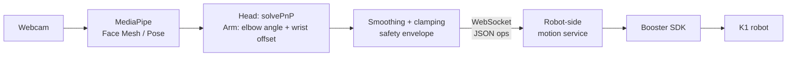

# K1 Movement Mimicry (beta)

Webcam → pose estimation → WebSocket → Booster K1 humanoid, so the robot imitates a person's head and arm movements in real time.

Developed against a Booster K1 through DUX Educacional (an official Booster Robotics partner in Brazil). It talks to a robot-side WebSocket motion service that is **not part of this repository**.

## Status

| Component | Status |
|---|---|
| `mimicHead.py` | **Working.** Verified on a physical K1. |
| `mimicArms.py` | **Beta, not verified end-to-end.** The client is complete; the robot-side service does not implement the arm protocol (`switch_arm_control` / `move_arm`) yet. |
| T2 support | **Research only.** See [`T2-ADAPTATION-PLAN.md`](T2-ADAPTATION-PLAN.md). Nothing has been tested on a T2. |

## How it works



**Head (`mimicHead.py`).** Six Face Mesh landmarks are matched to a generic 3D face model and passed to `cv2.solvePnP` to estimate real 3D head orientation. This replaced an earlier nose-position proxy, which barely moved when only the head turned. To keep `solvePnP` from jumping between ambiguous solutions, each frame is seeded with the previous estimate (`useExtrinsicGuess`), then filtered with an exponential moving average and a maximum per-update jump.

**Arms (`mimicArms.py`).** Extension comes from the elbow angle, which is invariant to camera distance. Lateral and vertical position come from the wrist's offset relative to the shoulder, normalized by the person's own shoulder-to-elbow length so it self-calibrates. The result is mapped to a target pose inside a Cartesian safety envelope. This is an approximation (no inverse kinematics, no metric depth).

## Design notes

- **Fire-and-forget sends.** The head client does not wait for the robot's reply inside the video loop; a slow RPC otherwise freezes the whole camera feed. Replies are drained periodically so the socket buffer does not grow.
- **Safety envelope.** Head yaw/pitch and arm x/y/z are clamped on the client; the robot is expected to clamp again.
- **No external WebSocket dependency.** A minimal RFC 6455 client is implemented with `socket` and `struct`.

## Requirements

```
pip install -r requirements.txt
```

`opencv-python`, `mediapipe`, `numpy`.

## Usage

Head mimicry:

```
ROBOT_IP=<robot-ip> python3 mimicHead.py
```

Arm mimicry (the motion service listens on `127.0.0.1` on the robot, so tunnel first):

```
ssh -N -L 8765:127.0.0.1:8765 <user>@<robot-ip>
ROBOT_IP=127.0.0.1 python3 mimicArms.py
```

Press ESC in the webcam window to quit. The scripts re-center the head / disable arm control before exiting. The port can be overridden with `ROBOT_MOTION_PORT` (default `8765`).

## Limitations

- Requires a compatible robot-side service; without one the scripts have nothing to talk to. No simulator or mock server is included yet.
- Head sign conventions (`YAW_SIGN`, `PITCH_SIGN`) were tuned live on one robot and may differ on another.
- The K1 has no wrist or hand joints, so wrist orientation and fingers are not mimicked.
- Single person, single webcam, 2D landmarks only; no depth.
- The WebSocket client is duplicated across the two scripts and there are no automated tests yet.

## Future work

- Mock WebSocket server for running without a robot.
- Extract the shared WebSocket client; add unit tests for the geometry functions (`_elbow_angle_deg`, `arm_target`).
- Deploy the robot-side arm protocol and validate `mimicArms.py` on hardware.
- T2 adaptation (see plan).
